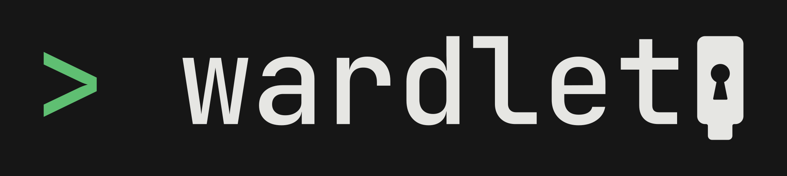

# Wardlet

<p align="center">
  
</p>

Your key is the lock.

Wardlet locks files with the security keys you already own. The locked copy sits next to the original, and nothing opens it without your key. No password, no account, no upload.

Free and open source. A command-line tool for Linux today, with a desktop app later that opens the same files.

## Quick start

Linux only for now. Build from source; packaged releases are next.

```bash
cargo build --release -p wardlet
install -m 755 target/release/wardlet ~/.local/bin/wardlet
```

If your security key already works for website login (FIDO2), try Wardlet next — no extra setup on most desktops.

If the key is not found or permission is denied, install the bundled udev rule (or your distro’s `libfido2` / FIDO udev package), then re-plug the key:

```bash
sudo install -m 644 packaging/udev/99-wardlet-fido2.rules /etc/udev/rules.d/
sudo udevadm control --reload-rules
```

Then:

```bash
wardlet init               # register your keys, get a one-time recovery code
wardlet enc taxes.pdf      # writes taxes.pdf.age beside the original
wardlet dec taxes.pdf.age  # tap a key to open
```

Linux x86_64 with glibc 2.34 or newer is needed. Rust 1.95 or newer is needed to build.

When a release is published, you can also download the binary and udev rule
from [GitHub Releases](https://github.com/deltreexyz/wardlet/releases) and
check the SHA256 checksum instead of building.

Keys that work are listed at [wardlet.com/#devices](https://wardlet.com/#devices).

Good for: SSH keys, `.env` files, tax documents, password-manager exports, scans, and private notes.

## How it works

1. **Set up with your keys.** `wardlet init` adds your first security key and shows a recovery code once. Save it. Add more keys later so a lost key is not the end.
2. **enc — lock a file.** `wardlet enc taxes.pdf` writes a locked copy beside the original, in the same folder. You decide when to delete the original. Files stay where they are.
3. **dec — tap to open.** `wardlet dec taxes.pdf.age` — plug in a key and tap it. Without a key, the file can't be read.

> **Changing keys creates a new recovery code.** Adding or removing a key shows a new recovery code once. Store it before you close the terminal. The old recovery code can still open files locked before the change. The new code opens files locked after it, and can open earlier files through the current vault (the small folder that holds your key settings, not your files).

## Why it's different

- **Your keys, not a password.** Nothing to invent, type or forget. Works with YubiKey, Trezor and similar FIDO2 keys. Add more than one.
- **Files stay where they are.** No mounted drive, no container, no sync conflicts.
- **Several keys, one lock.** Any key you add opens the files. Adding a key doesn't rewrite them.
- **A recovery code, shown once.** The way back in if every key is lost. Wardlet keeps no copy.
- **Nothing leaves your machine.** No account, no cloud, no upload.
- **Open format, open source.** Files use the age format. The source is public, so you can audit the lock yourself.

## Commands

`wardlet new notes.txt` creates a locked file in your editor, and `wardlet edit notes.txt.age` opens one and locks it again when you quit. The editor is `$EDITOR` if set, otherwise nano, falling back to vi.

`wardlet config` adds or removes keys, then saves the vault once when you quit and shows a new recovery code. After a change, export the vault and import it on every other computer. An older copy cannot open files locked after the change. The recovery code is not inside the export.

`wardlet status` prints the vault version without unlocking. Version 1 means your key settings haven't changed since setup.

An existing locked file is not overwritten unless you pass `--force`.

## FAQ

**How is this different from age plus a FIDO plugin?**
Underneath, Wardlet uses the age format and FIDO2 hmac-secret — the same building blocks as plugins like `age-plugin-fido2-hmac`. The difference is the product around them: Wardlet enrolls several keys and a recovery code in one vault, locks files beside the originals, and lets you add a key without rewriting existing locked files. If you already live in the `age` CLI and manage recipients yourself, a plugin may be enough. Wardlet is for people who want that workflow packaged.

**What are the limits?**
- You need compatible FIDO2 keys. Older keys (YubiKey 4, Trezor One, and similar) are not supported. See [wardlet.com/#devices](https://wardlet.com/#devices).
- The original file stays until you delete it.
- Removing a key does not rewrite files already locked. See the next question.
- Wardlet does not protect against malware running as you while a file is decrypted or open in an editor.
- Linux CLI today. Packaged downloads and other platforms come later.

**If I remove a key, is it revoked from old files?**
No. Removing a key updates the vault so that key cannot open files locked *after* the change. Files locked before the change are still tied to an older copy of your key settings. Anyone with that key and an older vault copy can still open them. To cut a key off: remove it, re-encrypt the files you care about, then delete the old locked copies and any old vault export.

**What if I lose every key?**
Use the recovery code shown once at setup (and again after you change keys in `wardlet config`). Store it in a password manager. Wardlet keeps no copy. Lose every key and the code, and the locked files cannot be opened.

**Is this an encrypted container?**
No. There's no mounted drive or container file. Each file is locked on its own, in the standard age format, and stays where it is.

## Desktop app (Linux)

An early GUI shares the same vault and files as the CLI:

```bash
cargo run -p wardlet-gui
```

See [crates/gui/README.md](crates/gui/README.md).

## Development

```bash
cargo test --workspace
```

See [CHANGELOG.md](CHANGELOG.md) for releases, [SECURITY.md](SECURITY.md)
for the threat model and how to report a problem, and
[docs/manual-hardware-checklist.md](docs/manual-hardware-checklist.md) for
the hardware checks run before a release.

## License

Licensed under either of

- Apache License, Version 2.0 ([LICENSE-APACHE](LICENSE-APACHE))
- MIT license ([LICENSE-MIT](LICENSE-MIT))

at your option.
